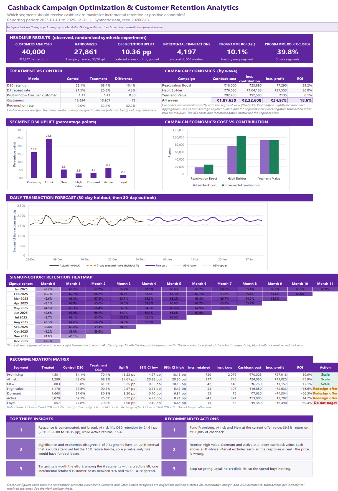

# Cashback Campaign Optimization & Customer Retention Analytics

**A randomized cashback experiment on 40,000 synthetic fintech customers that answers one
question with money attached: which segments should get the offer?**

Treating every eligible segment returns **10.1%** on ₹187,630 of cashback. Funding only the
three segments that clear both a statistical and a profitability hurdle returns **39.8%** —
on 54% of the spend. Three of seven segments produce a statistically credible retention lift
and still lose money, which is the whole point of the project.

> **Independent portfolio project using synthetic data. Not affiliated with or based on internal data from PhonePe.**



---

## Business problem

Cashback is the bluntest instrument in a payments growth team's toolkit. It reliably increases
redemptions, and redemptions reliably look like success — but a redemption by a customer who
would have transacted anyway is pure cost. The question that actually matters is *incrementality*:
how many customers transacted **because of** the offer, and did that lift pay for itself?

**Primary question:** Which customer segments should receive cashback offers to maximize
incremental retained users and transactions while maintaining positive campaign economics?

## The decision this supports

A quarterly targeting decision: for each RFM segment, choose one of four actions.

| Action | Condition |
|---|---|
| **Scale** | 95% CI lower bound > 0 **and** ROI >= 15% |
| **Test further** | positive uplift **and** ROI >= 0 |
| **Redesign offer** | 95% CI lower bound > 0 **but** ROI < 0 |
| **Do not target** | anything else |

Statistical significance alone never triggers a spend decision. The interval must exclude zero
*and* the offer must clear a 15% return hurdle.

## Synthetic dataset design

Everything is generated by `src/generate_data.py` from seed `20260813`. Re-running the pipeline
reproduces every file exactly.

| Table | Rows | Grain |
|---|---:|---|
| `customers` | 40,000 | one per customer |
| `transactions` | 373,237 | one per transaction (360,210 successful) |
| `campaigns` | 3 | one per campaign wave |
| `campaign_assignments` | 27,861 | one per customer per campaign |
| `cashback_redemptions` | 4,502 | one per redemption |
| `rfm_snapshots` | 100,170 | one per eligible customer per campaign |

The generator injects weekly and month-end seasonality, regional activity multipliers, natural
churn among at-risk and dormant customers, and **heterogeneous treatment effects** — some
segments were built to respond, others not. The analysis never reads the generator's intent:
`initial_customer_type` and `is_campaign_increment` exist only as audit fields and are excluded
from every metric.

Reporting period: **2025-01-01 to 2025-12-31**.

## Experiment design

- **Unit of randomization:** the customer, within each campaign wave.
- **Allocation:** 50/50 treatment/control, drawn *after* the RFM snapshot is frozen. Realized
  treatment share stays within 49.2%–51.8% in every segment.
- **Analysis:** intent-to-treat. The denominator is every assigned customer, whether or not they
  redeemed. Only `transaction_status = 'Success'` counts towards any outcome.
- **Balance:** standardized mean difference on pre-period transaction count peaks at **0.048**,
  comfortably inside the conventional ±0.10 threshold.

Three waves ran sequentially: *Reactivation Boost* (At risk + Dormant), *Habit Builder*
(Promising + Active) and *Year-end Value* (all segments).

### Leakage controls

Three independent guarantees, each enforced by a test:

1. Each RFM snapshot is cut **strictly before** its campaign's assignment date.
2. `tests/test_experiment_integrity.py` **recomputes every snapshot from the raw transaction
   table** and asserts a row-for-row match — so segmentation provably uses nothing but
   pre-assignment history.
3. Control customers never appear in the redemption table, and no injected transaction predates
   its campaign start or its customer's own signup date.

## KPI definitions

| KPI | Definition |
|---|---|
| **D30 retention** | at least one successful transaction on days 0–29 after campaign start |
| **D7 repeat** | at least one successful transaction on days 0–6 |
| **Absolute uplift** | treatment D30 rate − control D30 rate, in percentage points |
| **Incremental retained customers** | uplift × treated customers |
| **Incremental transactions** | (treatment mean post-window txns − control mean) × treated customers |
| **Cashback cost** | sum of actual redemptions by treated customers |
| **Incremental contribution** | incremental transactions × average payment value × 8% margin |
| **Incremental profit** | incremental contribution − cashback cost |
| **ROI** | incremental profit / cashback cost |
| **Cost per incremental retained** | cashback cost / incremental retained customers |

Confidence intervals are 95% normal-approximation intervals for a difference in proportions.

### Stated assumptions

Two numbers are assumptions rather than measurements, and both are exposed as editable cells in
the workbook rather than buried in code:

- **8% contribution margin** — a planning assumption, not a measured figure.
- **2.93 incremental transactions per incremental retained customer** — *derived* from the
  experiment as `sum(incremental_transactions) / sum(incremental_retained_customers)`, not
  hard-coded.

## RFM methodology

Recency, frequency and monetary value are ranked into quintiles (1–5) within each snapshot.
Ranking is used rather than fixed cut points so scores stay stable as the distribution shifts.
Business overlays are then applied **in order — first match wins**:

| Priority | Segment | Rule | Share of base |
|---|---|---|---:|
| 1 | New | signed up within 45 days of the snapshot | 13.0% |
| 2 | Dormant | recency > 120 days, or zero successful transactions | 9.6% |
| 3 | At risk | recency > 60 days with at least one transaction | 6.9% |
| 4 | High value | `m_score` = 5 and at least 8 transactions | 19.2% |
| 5 | Loyal | `r_score` >= 4 and `f_score` >= 4 | 10.6% |
| 6 | Active | `r_score` >= 3 and `f_score` >= 3 | 17.3% |
| 7 | Promising | everything else | 23.4% |

A customer who has not signed up by the cutoff is excluded from that snapshot entirely — they
cannot be targeted by a campaign that predates their own account.

## Findings

**1. Response is concentrated, not broad.** At risk lifts D30 retention by **24.61 pp**
(95% CI 20.88 to 28.35), while Loyal manages 1.98 pp with an interval that straddles zero. The
same offer produces a 22-point spread across segments.

**2. Statistical significance and profitability disagree in 3 of 7 segments.** Active, High value
and Dormant all show uplift intervals that exclude zero — and all three lose money. A
p-value-driven targeting rule would have funded ₹77,475 of cashback that returns nothing.

**3. Focus is worth roughly 4x.** Blanket targeting returns **10.1%** on ₹187,630. Funding only
Promising, At risk and New returns **39.8%** on ₹100,805 and captures ₹40,099 of the ₹18,881 net
programme profit — the excluded segments were dragging the total down.

**4. Acquisition cost varies 7x.** Among the six segments with a credible lift, buying one
incremental retained customer costs between **₹76** (At risk) and **₹499** (High value). That
spread is what makes targeting worth the effort at all.

**5. High-baseline segments have no room to move.** High value already retains 87.5% without any
offer; its 2.87 pp lift costs ₹499 per incremental customer. Cashback works on customers with
somewhere to go, not on the ones already there.

### Segment recommendations

| Segment | Treated | Control D30 | Treatment D30 | Uplift (pp) | 95% CI (pp) | Incr. retained | Cashback cost | Incr. profit | ROI | Action |
|---|---:|---:|---:|---:|---|---:|---:|---:|---:|---|
| Promising | 4,501 | 54.1% | 70.4% | +16.23 | 14.27 to 18.18 | 730 | ₹70,025 | ₹27,918 | 39.9% | **Scale** |
| At risk | 1,289 | 43.6% | 68.2% | +24.61 | 20.88 to 28.35 | 317 | ₹24,030 | ₹11,025 | 45.9% | **Scale** |
| New | 803 | 56.0% | 61.3% | +5.25 | 0.35 to 10.15 | 42 | ₹6,750 | ₹1,157 | 17.1% | **Scale** |
| Active | 3,879 | 69.1% | 75.3% | +6.22 | 4.22 to 8.21 | 241 | ₹53,005 | -₹7,792 | -14.7% | Redesign offer |
| High value | 1,178 | 87.5% | 90.3% | +2.87 | 0.31 to 5.43 | 34 | ₹16,850 | -₹2,633 | -15.6% | Redesign offer |
| Dormant | 1,660 | 27.6% | 30.8% | +3.20 | 0.10 to 6.31 | 53 | ₹7,620 | -₹4,304 | -56.5% | Redesign offer |
| Loyal | 657 | 77.8% | 79.8% | +1.98 | -2.49 to 6.45 | 13 | ₹9,350 | -₹6,490 | -69.4% | Do not target |

**Recommendation:** scale Promising, At risk and New at the current offer. Redesign Active,
High value and Dormant at a lower cashback value — each has a real lift that the current offer
price cannot pay for. Stop targeting Loyal.

## Forecast

Daily successful transactions are forecast 30 days ahead. Three deliberately transparent
candidates were compared on a **strictly chronological 30-day holdout** (2025-12-02 to
2025-12-31) that never touched model fitting or selection:

| Model | Holdout MAE | Holdout MAPE | Selected |
|---|---:|---:|---|
| 7-day seasonal naive | **127.03** | 7.80% | ✅ |
| 28-day moving average | 127.67 | 7.27% | |
| Holt-Winters additive | 153.14 | 9.26% | |

Selection is on MAE, and the margin over the moving average is thin — 0.6 transactions per day
on a holdout averaging 1,711. The moving average actually wins on MAPE. Reporting both metrics
and both losing candidates is the honest presentation: this is a *baseline* forecast, and the
right conclusion is that daily volume is close to a flat weekly pattern, not that one model is
meaningfully better. The forecast window is 2026-01-01 to 2026-01-30, with intervals at
±1.96 × the holdout residual standard deviation.

## Dashboard

`outputs/cashback_retention_dashboard.xlsx` — 11 sheets, built with XlsxWriter and independently
audited with openpyxl.

| Sheet | Contents |
|---|---|
| Executive Dashboard | KPI cards, treatment vs control, segment uplift chart, campaign economics chart, forecast chart, cohort heatmap, recommendation matrix, three insights, three actions |
| Campaign Performance | Per-wave results, cost, return and campaign design |
| Segment Analysis | Full segment table with CIs, p-values, economics and balance diagnostics |
| Cohort Retention | Signup-cohort heatmap with reading notes |
| Experiment Results | Design, balance diagnostics, 16 data-quality checks, scenario range |
| Forecast | Holdout series, model comparison, split and accuracy |
| **Offer Simulator** | Six editable inputs driving ten live formulas, including break-even uplift |
| **KPI Calculations** | Raw counts on the left, every KPI derived beside them in live formulas |
| Data Dictionary | Every table and column |
| Methodology | How each number was produced, and its limitations |
| Raw Data Sample | 250 committed transaction rows |

Design notes: purple/white/dark-grey fintech palette with restrained green/amber/red accents;
frozen panes and hidden gridlines on presentation sheets; Indian-rupee, percentage, percentage-point
and date formats throughout; editable inputs, calculated outputs and source data are visually
distinct and labelled in a legend.

**The Offer Simulator and KPI Calculations sheets contain no pasted numbers.** Every output is an
Excel formula pointing at labelled input cells — change the margin assumption and the whole
programme re-prices. `src/verify_workbook.py` opens the finished workbook through Excel COM,
forces a full recalculation, and asserts that no cell evaluates to `#REF!`, `#VALUE!`, `#DIV/0!`,
`#NAME?` or `#N/A`.

## Technical workflow

```
generate_data.py   seeded synthetic tables -> CSV + SQLite, with pre-campaign RFM snapshots
validate_data.py   16 integrity checks; the pipeline aborts if any fails
build_segments.py  latest snapshot + per-segment RFM profile
analyze_experiment.py  uplift, CIs, p-values, balance, economics, action rule, scenarios
build_cohorts.py   signup-cohort retention with fixed denominators
build_forecast.py  3 candidates, chronological holdout, winner + intervals
write_docs.py      regenerates every markdown deliverable from the artefacts
build_workbook.py  the 11-sheet Excel workbook
verify_workbook.py static audit + Excel recalculation + PNG rendering
```

Every document is generated from the pipeline's own outputs, so the executive summary and
stakeholder brief cannot drift away from the data.

## Reproducing this project

```bash
pip install -r requirements.txt
```

```bash
python src/run_pipeline.py
```

```bash
python src/build_workbook.py && python src/verify_workbook.py
```

```bash
python -m pytest
```

The pipeline takes about a minute and writes `data/processed/`, `database/cashback_analytics.db`
and `outputs/`. The workbook verification step needs Microsoft Excel on Windows for the
recalculation and rendering pass; without it the static audit still runs and the suite skips the
Excel-only test.

## SQL highlights

Eight files in `sql/` covering 13 documented business questions, written against the generated
SQLite database. `tests/test_sql_agreement.py` executes the important ones and asserts they match
the Python pipeline to within 1e-6 — if SQL and Python ever disagree, the build fails.

| File | Questions | Technique |
|---|---|---|
| `01_data_quality.sql` | keys, orphans, negative amounts | conditional aggregation |
| `02_pre_campaign_behavior.sql` | 30-day pre-period behaviour by arm | date-bounded `LEFT JOIN` in the join predicate |
| `03_rfm_segmentation.sql` | RFM scoring and segment sizes | `NTILE(5) OVER (PARTITION BY ...)` |
| `04_cohort_retention.sql` | cohort retention matrix | month arithmetic on `substr` keys |
| `05_experiment_analysis.sql` | D7/D30 rates, balance | `MAX(CASE WHEN ...)` window flags |
| `06_campaign_economics.sql` | redemption rate, incremental volume | self-join of treatment vs control |
| `07_segment_opportunity.sql` | segment uplift ranking | `RANK() OVER (ORDER BY ...)` |
| `08_forecast_inputs.sql` | gap-filled daily series and split | `WITH RECURSIVE` date spine |

The recursive date spine matters: without it, a day with zero transactions silently disappears
and the forecast trains on a series with holes.

## Repository structure

```
cashback-retention-analytics/
├── README.md
├── LICENSE                       MIT
├── requirements.txt
├── pytest.ini
├── data/
│   ├── README.md
│   └── processed/                *_sample.csv committed; full CSVs generated locally
├── database/                     SQLite database generated locally, not committed
├── docs/
│   ├── methodology.md            data generation, RFM rules, economics, assumptions
│   ├── experiment_design.md      design, metrics, balance checks, decision rule
│   ├── data_dictionary.md        every table and column
│   ├── stakeholder_brief.md      one-page decision memo
│   └── interview_talking_points.md  5 STAR stories, 5 Q&A, 2 resume bullets, 60-second pitch
├── outputs/
│   ├── cashback_retention_dashboard.xlsx
│   ├── dashboard_preview.png
│   ├── executive_summary.md
│   ├── segment_recommendations.csv, campaign_performance.csv, scenarios.csv
│   ├── cohort_retention*.csv, forecast*.csv, segment_profile.csv
│   └── data_quality_report.json, experiment_notes.json, workbook_verification.json
├── sql/                          8 files, 13 documented business questions
├── src/                          9 modules, one responsibility each
└── tests/                        116 tests
```

Full generated CSVs (~30 MB) and the SQLite database (~40 MB) are gitignored. Deterministic
250-row samples are committed so the schema is reviewable without running anything.

## Limitations

- **The data is synthetic.** Effects were injected by the generator, so the results demonstrate
  method, not real-world PhonePe response. Every number here should be revalidated in a real
  randomized pilot.
- **The 8% contribution margin is assumed.** A real margin below 8% pushes New, the marginal
  Scale segment at 17.1% ROI, below the hurdle.
- **Segment cuts are exploratory.** No multiplicity adjustment is applied across seven segments,
  so the true intervals are wider than printed — the marginal segments (New, High value, Dormant)
  are the ones most likely to be noise.
- **Waves ran sequentially.** A customer treated in an earlier wave can enter a later wave's
  eligible pool through their improved RFM position. Randomization inside each wave keeps the
  within-wave contrast unbiased, but pooled segment reads inherit that selection.
- **D30 is a short horizon.** It captures reactivation, not habit formation or offer fatigue. A
  segment that looks profitable at D30 could still be training customers to wait for discounts.
- **The forecast is a baseline.** A 0.6-transaction MAE gap between the top two candidates is not
  a meaningful model win, and no external drivers (marketing spend, holidays, outages) are modelled.

## Relevance to the PhonePe Graduate Trainee role

This project was built to practise the analytical work a payments growth team actually does.

- **The core skills map directly.** SQL against a normalized schema (window functions, recursive
  CTEs, self-joins), Python for the pipeline, and Excel as the delivery layer — because the people
  who approve a cashback budget open a spreadsheet, not a notebook.
- **It treats an offer as a P&L decision, not a metric.** The output is not "retention went up";
  it is "fund these three segments, redesign these three, stop this one, and here is the rupee
  consequence of each." Three segments in this dataset are statistically significant and
  unprofitable, and the analysis says so.
- **It is auditable end to end.** One seeded command regenerates the data, the metrics, the
  workbook and the documents. 116 tests assert that the SQL agrees with the Python, that the
  workbook agrees with the analysis, and that no segment is defined by post-treatment information.
- **It is honest about its limits.** Synthetic data, an assumed margin, unadjusted multiplicity
  and a thin forecast margin are stated plainly rather than smoothed over — including in the
  dashboard the stakeholder actually reads.

---

**Independent portfolio project using synthetic data. Not affiliated with or based on internal data from PhonePe.**

No PhonePe systems, data, or proprietary information were accessed. Company names are referenced
only to describe the kind of role this work is relevant to.
